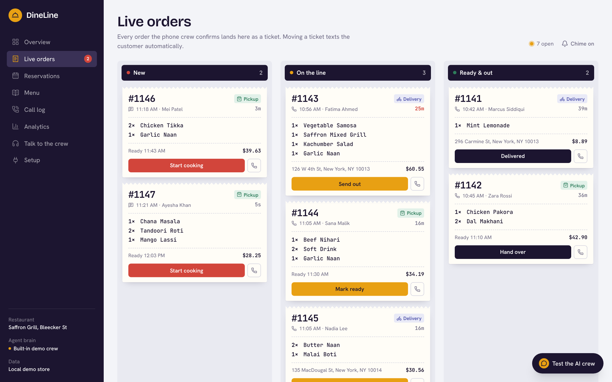
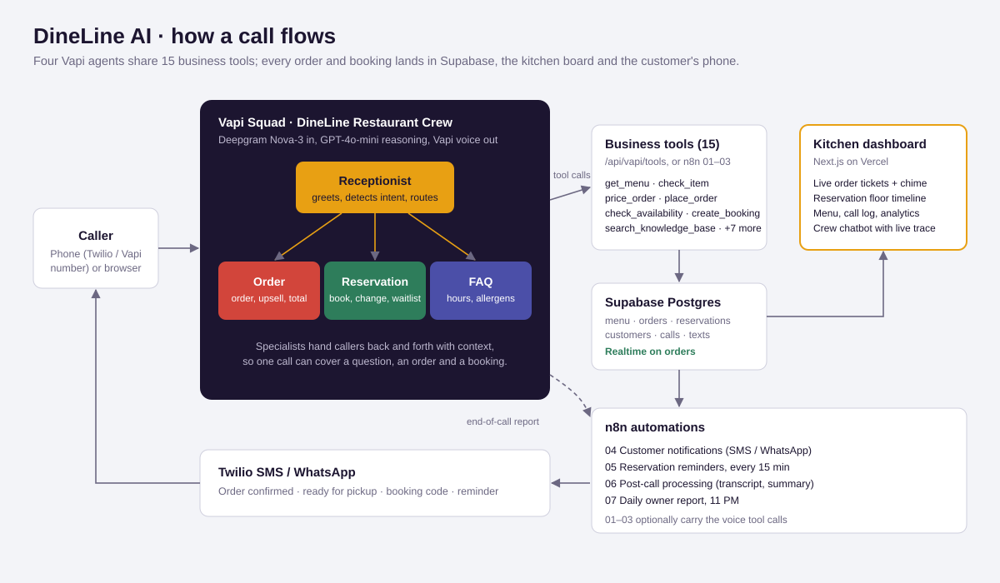

# DineLine AI — Multi-Agent Restaurant Voice Crew

**A four-agent AI phone team for restaurants.** It answers every call, takes pickup and delivery orders with a natural upsell, books and changes tables, answers menu and allergen questions, and sends every order to a live kitchen board while the customer gets a text confirmation.

Built around a demo restaurant, **Saffron Grill** (New York), and designed to be resold to any restaurant by editing one settings record.



---

## What it does

| | |
| --- | --- |
| **Receptionist agent** | Greets callers (by name if they've ordered before), detects intent and hands off to the right specialist with context, so nobody repeats themselves. Transfers to staff on request. |
| **Order agent** | Takes the full order from the live menu (sizes, quantities, special requests), checks sold-out items and suggests swaps, checks the delivery zone, upsells once, reads back the total with tax and fees, and places the order. Offers "same as last time" to returning customers. |
| **Reservation agent** | Checks live table availability, offers the nearest open times when a slot is full, books, modifies and cancels bookings, and manages a waitlist. |
| **FAQ agent** | Answers hours, location, parking, delivery area, payment, halal, allergens and dietary questions from the knowledge base and menu data, then hands off when the caller is ready to order or book. |
| **Kitchen dashboard** | Live order tickets with a chime for new phone orders; moving a ticket texts the customer. Plus a reservation floor timeline, menu manager with a sold-out toggle, call log with transcripts, and analytics. |
| **Built-in chatbot** | Talk to the crew from the dashboard by text or voice (browser speech) and watch every handoff and tool call live. |

## Architecture



- **Voice layer:** a Vapi Squad of four assistants that hand callers to each other.
- **Business tools:** 15 tools (menu, pricing, orders, availability, bookings, knowledge base) served by the app at `/api/vapi/tools`, or through n8n workflows 01–03.
- **Automation:** n8n handles texts (SMS/WhatsApp via Twilio), reservation reminders, post-call processing and a nightly owner report.
- **Data:** Supabase Postgres (with Realtime) in production; a local JSON store with a week of demo history out of the box.
- **Dashboard:** Next.js 16, React 19, Tailwind CSS 4, Recharts.
- **Agent brain for web chat:** any OpenAI-compatible LLM (Gemini, OpenAI, Groq, OpenRouter) running the same four agents and tools, or a built-in rule-based crew when no key is set.

## Quick start (demo mode, no accounts needed)

```bash
npm install
npm run dev
```

Open http://localhost:3000, click **Talk to the crew**, and try:

- "2 chicken biryani family size and a garlic naan for delivery to 45 Carmine St 10014"
- "Can I book a table for 4 this Friday at 8pm?"
- "Is the butter chicken nut-free?"

Then watch the order land on **Live orders**, the booking on **Reservations** and the conversation in the **Call log**.

To give the agents a real AI brain, add a free Gemini key to `.env.local`:

```env
LLM_PROVIDER=gemini
LLM_API_KEY=your-key
LLM_MODEL=gemini-3.8-flash
```

## Going live

Full step-by-step instructions are in **[docs/SETUP.md](docs/SETUP.md)**. The full technical delivery report (architecture, agents, CRM, cost model, testing) is in **[docs/DineLine-AI-Technical-Delivery-Report.pdf](docs/DineLine-AI-Technical-Delivery-Report.pdf)**. In short:

1. **Supabase:** run `supabase/schema.sql` and `supabase/seed.sql`, set `SUPABASE_URL` and `SUPABASE_SERVICE_ROLE_KEY`, then `npm run seed:supabase` for demo history.
2. **Public URL:** deploy to Vercel or run an ngrok / Cloudflare tunnel, and set `PUBLIC_APP_URL`.
3. **Vapi:** set `VAPI_PRIVATE_KEY`, then `npm run setup:vapi`. This creates the tools, the four assistants and the squad, and can attach the squad to your phone number.
4. **Texts:** import n8n workflow 04 and set `N8N_NOTIFY_WEBHOOK_URL`, or set the `TWILIO_*` variables to text straight from the app.
5. **n8n:** import the seven workflows in `n8n/`, fill in each **Config** node, and activate.

## n8n workflows

| # | Workflow | Trigger | What it does |
| --- | --- | --- | --- |
| 01 | Menu, Caller & FAQ Lookup | Vapi tool call | Live menu, item details, delivery zone, knowledge base, caller lookup, order status |
| 02 | Order Placement | Vapi tool call | Prices and places orders; the ticket hits the kitchen board |
| 03 | Reservation Manager | Vapi tool call | Availability, booking, changes, cancellations, waitlist |
| 04 | Customer Notifications | Webhook from the app | SMS or WhatsApp confirmations and status updates via Twilio |
| 05 | Reservation Reminders | Every 15 minutes | Texts guests 2 hours before their booking |
| 06 | Post-Call Processing | Vapi end-of-call report | Saves transcript, recording, AI summary, outcome and cost to the call log |
| 07 | Daily Owner Report | 11 PM nightly | WhatsApps the owner the day's calls, orders, revenue and top dishes |

## Agent tools

| Agent | Tools |
| --- | --- |
| Receptionist | `lookup_caller`, `get_order_status`, `transfer_to_staff`, handoff |
| Order | `get_menu`, `check_item`, `check_delivery_zone`, `price_order`, `place_order`, `get_order_status`, `lookup_caller`, handoff |
| Reservation | `check_availability`, `create_booking`, `find_booking`, `modify_booking`, `cancel_booking`, `join_waitlist`, `lookup_caller`, handoff |
| FAQ | `search_knowledge_base`, `check_item`, `get_menu`, `transfer_to_staff`, handoff |

The full prompts and tool schemas are exported to [`vapi/squad.config.json`](vapi/squad.config.json).

## API

| Endpoint | Used by | Purpose |
| --- | --- | --- |
| `POST /api/vapi/tools` | Vapi | Runs tool calls and answers in Vapi's `results` format |
| `POST /api/vapi/webhook` | Vapi / n8n 06 | Stores end-of-call reports |
| `POST /api/tools/execute` | n8n 01–03 | Runs a single tool: `{ name, args, callerPhone, callId }` |
| `GET/POST /api/reservations/reminders` | n8n 05 | Due reminders with ready-to-send text; mark them sent |
| `GET /api/reports/daily` | n8n 07 | Today's numbers and a ready-to-send summary |
| `POST /api/chat` | Dashboard chatbot | Runs one turn of the crew |
| `GET /api/orders`, `PATCH /api/orders/:id` | Dashboard | Kitchen board; status changes text the customer |
| `GET /api/reservations`, `PATCH /api/reservations/:id` | Dashboard | Reservation book |
| `GET /api/menu`, `PATCH /api/menu/:id` | Dashboard | Menu manager (prices, sold out, upsell) |
| `GET /api/calls`, `GET /api/calls/:id` | Dashboard | Call log |
| `GET /api/analytics` | Dashboard | Metrics and charts |

Webhook endpoints check the `x-dineline-secret` header when `DINELINE_WEBHOOK_SECRET` is set.

## Project structure

```
app/                  Next.js pages and API routes
  api/                REST endpoints for the dashboard, Vapi and n8n
components/           Dashboard UI (kitchen tickets, crew chat, sidebar)
lib/
  agents/             Agent definitions and prompts, LLM crew orchestrator, built-in demo crew
  store/              Data layer: local JSON store and Supabase store behind one interface
  tools.ts            The 15 business tools shared by Vapi, n8n and the web chat
  seed.ts             Saffron Grill settings, menu, tables, knowledge base and demo history
n8n/                  Seven importable n8n workflows
supabase/             schema.sql and seed.sql
vapi/                 Squad setup script and exported squad config
scripts/              Crew test runner, Supabase seeder, SQL and config generators
docs/                 Setup guide, delivery report (PDF), architecture diagram, screenshots
```

## Testing

```bash
npm run test:crew   # scripted calls through the crew: orders, upsell, bookings, cancellations, FAQs
npm run typecheck
npm run build
```

## Deploy

Deploy to Vercel, add the environment variables from `.env.example`, and connect Supabase (the local JSON store is in-memory on serverless hosts). Point `PUBLIC_APP_URL` at the deployment and re-run `npm run setup:vapi`.

---

Built by **Muhammad Hassan**, AI Automation Engineer & Full Stack Developer.
